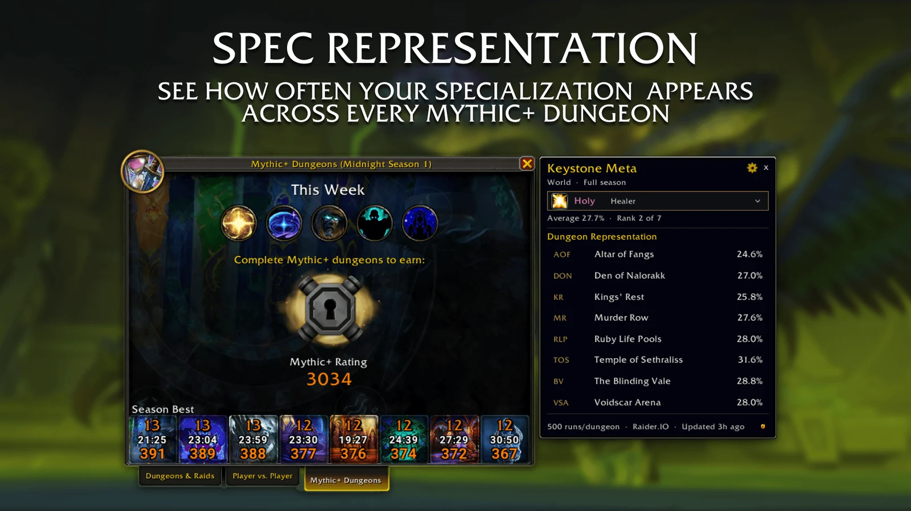
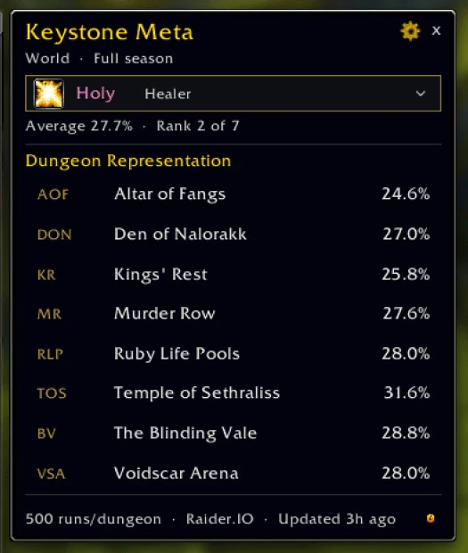
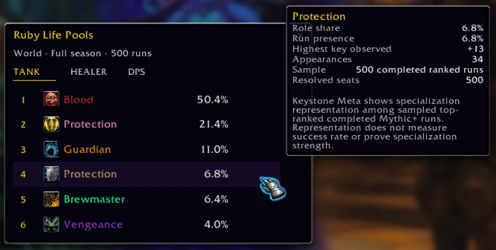
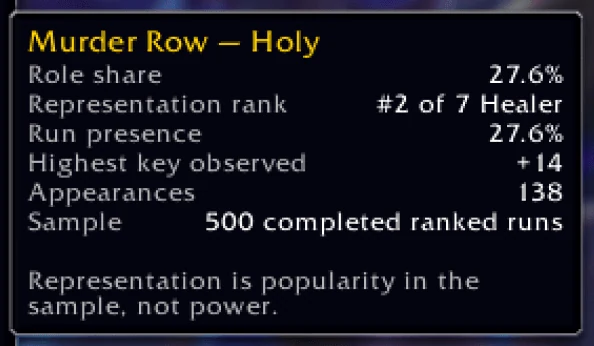

<h1 align="center">Keystone Meta</h1>

<p align="center">
  <b>See what the best Mythic+ groups are actually playing.</b>
</p>

<p align="center">
  A World of Warcraft addon that shows how often every specialization appears in top-ranked Mythic+ runs.<br>
  Check your own spec in every dungeon, or open a dungeon to see the most played tanks, healers and DPS.
</p>

<p align="center">
  <sub>World of Warcraft Retail &nbsp;·&nbsp; Top-ranked runs worldwide &nbsp;·&nbsp; Updated every day &nbsp;·&nbsp; Free</sub>
</p>

<p align="center">
  <a href="https://www.curseforge.com/wow/addons/keystonemeta"></a>
  <a href="https://www.curseforge.com/wow/addons/keystonemeta"></a>
</p>

<p align="center">
  <a href="https://www.curseforge.com/wow/addons/keystonemeta"><b>Download on CurseForge</b></a> &nbsp;·&nbsp;
  <a href="#features">Features</a> &nbsp;·&nbsp;
  <a href="#getting-started">Getting started</a> &nbsp;·&nbsp;
  <a href="#feedback">Feedback</a>
</p>

<p align="center">
  <a href="https://www.buymeacoffee.com/xtendr"></a>
</p>

<br>



```
Open the Mythic+ window  →  Pick a specialization  →  See where it shows up in top runs  →  Open any dungeon for the full picture
```

## Features

### Your spec in every dungeon

<p align="center">
  
</p>

Open the Mythic+ Dungeons window and Keystone Meta sits right beside it. It follows the specialization you are playing
and shows how often it appears in top-ranked runs of every dungeon, plus its average and its rank within your role.
Curious about another spec? Click the name and browse them all.

### Open any dungeon



Click a dungeon to open its detail window. Switch between **Tank**, **Healer** and **DPS** to see every specialization
ranked by how often it shows up in that dungeon, with the sample size right at the top.

### Numbers with context

<table>
  <tr>
    <td width="52%" valign="top">
      
    </td>
    <td width="48%" valign="top">
      <p>Hover any result to see what's behind the number:</p>
      <p><b>Role share:</b> its share of all seats for that role.<br>
      <b>Run presence:</b> how many runs included it.<br>
      <b>Highest key:</b> the highest timed key it appeared in.<br>
      <b>Appearances and sample:</b> how many runs the number is built on.</p>
    </td>
  </tr>
</table>

> [!NOTE]
> Keystone Meta shows **popularity, not power**. A spec that appears often is popular among top groups. That doesn't
> prove it is stronger or more successful, so this is not a tier list.

### Fresh every day

A new snapshot of top-ranked runs from Raider.IO ships as a normal addon update every day, so it's ready the moment you
log in. The addon never goes online from inside the game. Every update is checked first, and if something looks wrong
you simply keep the last good data. Turn on **Daily movement** to see how each spec's share changed since the previous
update.

### Fits your setup

Choose whether the panel opens together with the Group Finder, and set its size, background opacity and compact rows in
the settings. With Group Finder closed, you can drag it anywhere as a standalone window. It needs no other addon, and
when [Keystone Cutoffs](https://github.com/Xtendr/Keystone-Cutoffs) is on too, the two sit neatly side by side.

## Getting started

1. Install Keystone Meta from [CurseForge](https://www.curseforge.com/wow/addons/keystonemeta), with the CurseForge
   app or your favourite addon manager.
2. Log in and open the **Mythic+ Dungeons** window. The panel appears next to it, showing your current specialization.

| | Do this |
| --- | --- |
| **Open settings** | Left-click the minimap button |
| **Show or hide the panel** | Right-click the minimap button, or type `/kmeta` or `/keystonemeta` |
| **Look at another spec** | Click the specialization name at the top of the panel |
| **See a whole dungeon** | Click a dungeon row |
| **Move the panel** | Drag it while the Group Finder is closed |

## About the data

The numbers come from up to 500 completed, top-ranked Mythic+ runs per dungeon, worldwide, across the whole season.
The exact sample size is shown for every dungeon. For the full details, see [how the data works](docs/DATA-METHODOLOGY.md).

## Feedback

Have an idea, found a bug or missing a feature? [Open an issue](https://github.com/Xtendr/Keystone-Meta/issues)
here on GitHub or leave a comment on [CurseForge](https://www.curseforge.com/wow/addons/keystonemeta).

## Credits

Ranked-run data comes from [Raider.IO](https://raider.io). Keystone Meta is a community addon and is not affiliated with
or endorsed by Raider.IO or Blizzard Entertainment.

<br>

<p align="center">
  <sub>Made by <a href="https://github.com/Xtendr">Nicolai Brøndum Knudsen</a>.</sub>
</p>
